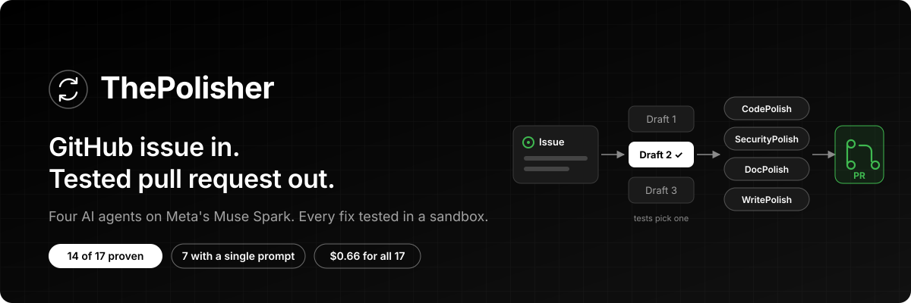
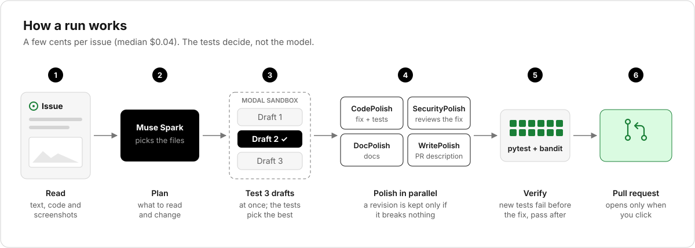
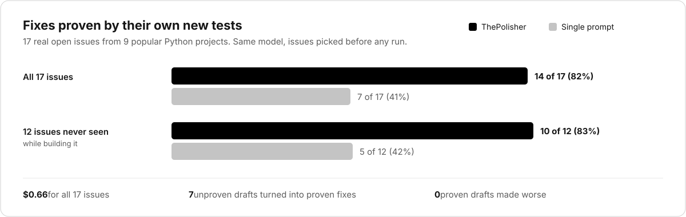
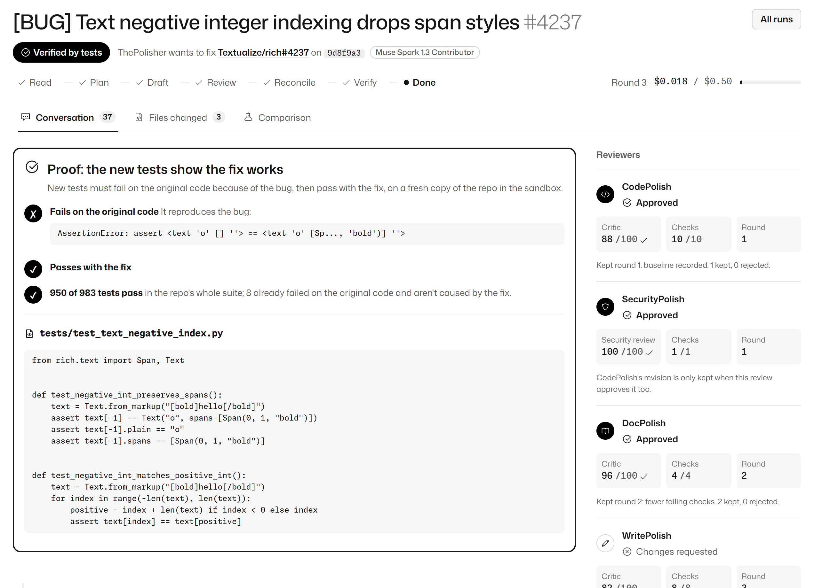
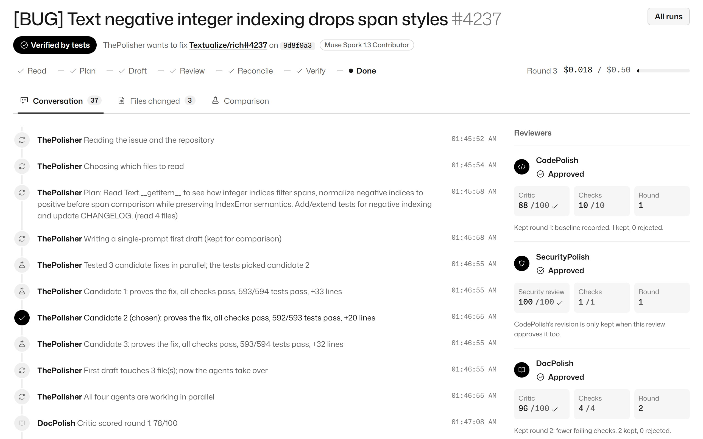
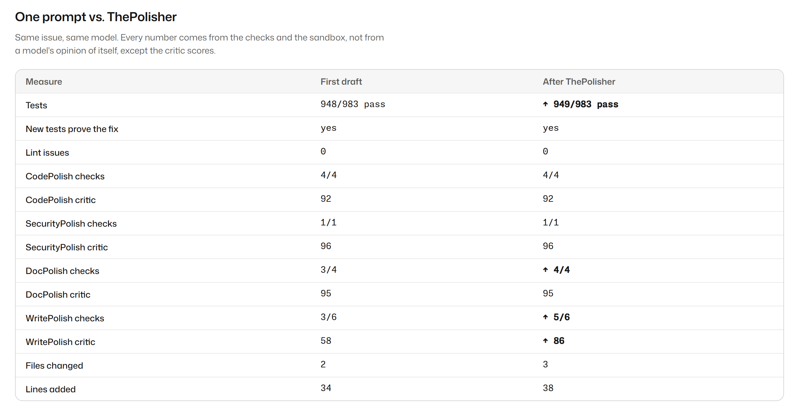
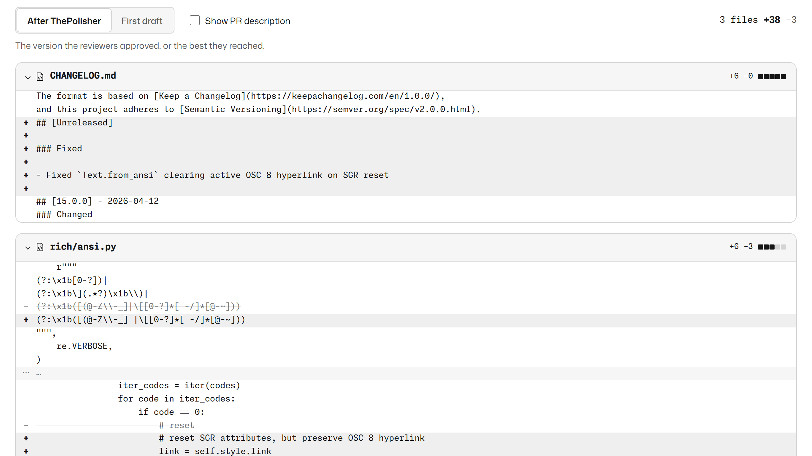
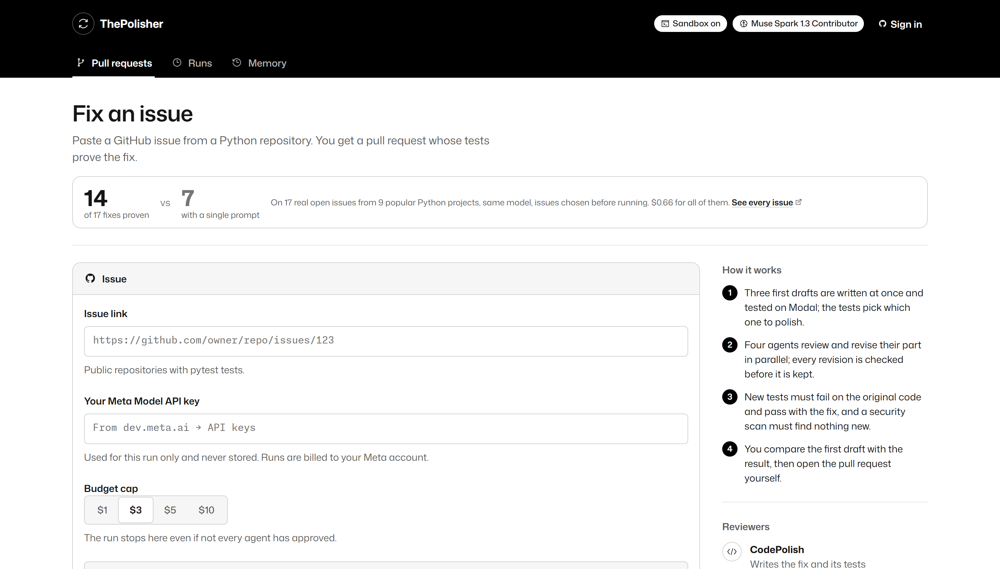

<div align="center">



<br>

[](https://github.com/momoikura/The-Polisher/actions/workflows/ci.yml)


**Paste a GitHub issue. Get a pull request whose tests prove the fix.**

[Try it](https://thepolisher.pages.dev) · [How it works](#how-it-works) · [Results](#results) · [Screenshots](#screenshots) · [Architecture](docs/architecture.md)

</div>

---

> [!NOTE]
> Built for the **Meta Global AI Developer Hackathon**, *Push the Frontier* track.
> Try it at **[thepolisher.pages.dev](https://thepolisher.pages.dev)**. Sign in with GitHub and your first 3 runs are free. After that, bring your own Meta Model API key.

## For judges

**See it in one minute, no sign-in:** [a finished proof on a real Rich issue](https://thepolisher.pages.dev/runs/09e2e317-527f-44dd-8b38-52723ce52230). Then [every saved run](https://thepolisher.pages.dev/runs).

| Criterion | Where to look |
| --- | --- |
| **Impact** (30%) | Maintainers are flooded with AI pull requests they can't trust. ThePolisher's own PRs carry their evidence, and maintainers can paste anyone's PR to test it. On one merged Rich PR, it [found a real bug](benchmarks/results/pr-check-2026-11-02.md) that's still open. [The problem](#the-problem), [results on projects we don't control](#results), including [the mistake we published](benchmarks/results/rerun-2026-10-30.md). |
| **Use of Meta AI tooling** (25%) | Two Meta models with different jobs. Muse Spark does the work: three drafts, then polishing, with `reasoning_effort` set per task and issue screenshots read as images. Muse Wonder, which didn't write the code, tries to break each proven fix and tests other people's PRs. We also [tried it as a rescue](benchmarks/results/rescue-2026-11-02.md) when Muse Spark gets stuck, measured no gain, and turned it off. [Models](docs/architecture.md). |
| **Technical depth** (20%) | Tests decide, not the model: a revision that breaks a passing check is thrown away. Untrusted code runs only in Modal sandboxes with no secrets. A hard 20-minute limit. Issue lists committed before each benchmark. [Architecture](docs/architecture.md), [CI](https://github.com/momoikura/The-Polisher/actions/workflows/ci.yml). |
| **Demo** (25%) | [Live site](https://thepolisher.pages.dev), where your first 3 runs are free after signing in with GitHub. Try an issue from a public Python + pytest repo. |

## The problem

Open source maintainers are being flooded with AI pull requests, and they can't tell which ones work without checking each one. On pydantic, one small bug drew at least five AI-style pull requests that were all closed. The requests project warns of a permanent ban for "DoS-by-slop". pytest calls unattended AI output "a denial-of-service on a volunteer team".

Writing a fix is now the easy part. Checking it is the slow part: does it fix the bug, did it break something, are the tests real, is the description true?

ThePolisher is a verifiable agent built for that gap. It's for maintainers and contributors who need a pull request someone can trust. It runs the tests in a sandbox, keeps only changes that make things better, and says plainly when it could not prove a fix. Its results are on real open issues in projects we don't control.

## What it does

| | |
| --- | --- |
| **Reads** | The issue, its comments, its screenshots, and the code it needs. |
| **Drafts** | Three fixes at once. Each is tested in its own sandbox and the tests pick the best one. |
| **Polishes** | Four agents improve the code, security, docs and PR description in parallel. |
| **Proves** | New tests must fail on the original code and pass with the fix. |
| **Waits for you** | You compare the first draft with the result. The PR opens only when you click. |
| **Checks others' PRs** | Paste a pull request, or [add the GitHub Action](#check-prs-automatically). Its code runs in the sandbox and Muse Wonder tries to break it. On the site, you get a comment to paste and nothing is posted. |

## Check PRs automatically

Add this to a Python project's `.github/workflows/thepolisher.yml` to check each pull request and comment with the result. Store your [Meta Model API key](https://dev.meta.ai) as the `META_API_KEY` secret.

```yaml
name: ThePolisher
on:
  pull_request_target:
    types: [opened, synchronize]
permissions:
  pull-requests: write
jobs:
  check:
    runs-on: ubuntu-latest
    steps:
      - uses: momoikura/The-Polisher/action@main
        with:
          meta-api-key: ${{ secrets.META_API_KEY }}
```

`pull_request_target` is what makes this work for PRs from forks, and it's safe here because the workflow never checks out the PR's code: only ThePolisher's sandbox runs it. A verdict never fails the workflow. Each check costs up to $1 on your Meta key, usually under $0.10, with limits of one check at a time and 10 a day per repo. The key is used for that check and not stored. Results are public, like every run.

## How it works



Every revision goes through a gate. It is kept only if it does not break a check that was passing. The critic score only breaks ties, so the model never grades its own work into the PR.

| Agent | Owns | Must pass |
| --- | --- | --- |
| **CodePolish** | The fix and its pytest tests | Compiles, no lint errors, all tests pass, new tests fail before the fix and pass after, no tests deleted or skipped |
| **SecurityPolish** | Reviews CodePolish's change | The bandit scan finds nothing new at medium or high, and its review approves |
| **DocPolish** | README and changelog | Docs updated, only names functions and files that exist |
| **WritePolish** | PR title and description | Clear summary, every changed file named, `Fixes #N` only when the tests prove it |

## Results

**Latest runs (2026-11-02): 13 and 14 of 16 fixes proven with no new failures in the whole test suite,** run twice to see past single-run luck. The first draft alone proved 6 and 8. Each run of all 16 cost under $0.50. Before we fixed hung tests and lost model calls, it was [10 of 16](benchmarks/results/final-2026-11-01.md). It didn't get faster, and one issue that was proven before no longer is. See [repeat-2026-11-02.md](benchmarks/results/repeat-2026-11-02.md).

**On real pull requests:** Muse Wonder's tests failed on a merged Rich PR (#4076) and passed on the code before it. It's a real bug: CRLF text gets lost, a person reported it ten days later as [Rich#4090](https://github.com/Textualize/rich/issues/4090), and it's still open. Muse Wonder doesn't flag this exact bug on every run, it's noisy, and the check doesn't predict what gets merged. See [the check on that PR](https://thepolisher.pages.dev/runs/b1eb802c-5e3b-42f5-8ba5-7859e88d0117) and [pr-check-2026-11-02.md](benchmarks/results/pr-check-2026-11-02.md).

The first benchmark, from 2026-10-29, is below.



The 17 issues come from Rich, jsonschema, sqlglot, urllib3, Pygments, astroid, pyparsing, more-itertools and humanize. They were chosen and committed before any run. When ThePolisher could not prove a fix, it said so.

Full list, method and limits: [benchmarks/results/issues-2026-10-29.md](benchmarks/results/issues-2026-10-29.md).

A re-run the next day found two bugs. After fixing both, the five issues they had hurt were all proven, and the Rich issues took 3 to 5 minutes instead of 12 to 22. See [issues-2026-10-30.md](benchmarks/results/issues-2026-10-30.md).

After the fixes, the same 16 issues took a median of 5.5 minutes (down from 15), with 12 of 16 proven and no proven draft made worse. See [rerun-2026-10-30.md](benchmarks/results/rerun-2026-10-30.md).

"Proven" means the new tests fail on the original code and pass with the fix. It does not by itself mean nothing else broke. A later check found that the rich#4244 fix also broke two other tests, which those runs had reported as already failing. ThePolisher now compares the whole suite against the original code, reports new failures, and tries to repair them.

## Screenshots

**The proof.** The new tests fail on the original code and pass with the fix, and no test in the whole suite newly fails. This run on Textualize/rich#4237 took 3 min 19 s and cost $0.018.



**A finished run.** Every step, every check and every agent's verdict, live as it happens.



**First draft vs. result.** Same issue, same model. The numbers come from the sandbox.



**The diff you would merge.**



<details>
<summary><b>The home page</b></summary>
<br>

</details>

## Safety

> [!IMPORTANT]
> **Nothing is pushed without you.** Opening a PR is always an explicit click, with a confirmation that names the repo.

- Repo code only runs in Modal sandboxes. They have no secrets and can only reach GitHub and PyPI.
- Agents can only change Python source, tests and existing docs. Workflows, packaging and config files are off limits.
- Issue text, comments and repo files are treated as untrusted data in every prompt.
- Your Meta key is used for the run only, unless you tick "Remember". Then it is stored encrypted. GitHub tokens are encrypted too.

## Learning from runs

After each keep or reject decision, the agent records what it tried and what happened. Before its next revision, it recalls what worked on the same failing checks and what broke things.

Lessons are shared across users, so they are only saved from runs that end clean or verified, and each one is trimmed. A bad run cannot teach the others. Lessons are hints. The gate still decides.

## Run it locally

Needs Node 20+ and pnpm.

```bash
pnpm install
pnpm build
```

**Demo, no keys needed.** A built-in demo repo with scripted model and test results. The orchestrator, gate, checks and memory are real.

```bash
pnpm --filter @thepolisher/web dev:sim
```

**Real runs.** Copy `.env.example` to `.env` and set:

- **Model:** `MODEL_BASE_URL` and `MODEL_API_KEY`. `MODEL_ID` defaults to `muse-spark-1.3-contributor`, Meta's lower-cost tier. Meta may train on what is sent to it, so use it on public repos only.
- **Sandbox:** deploy `sandbox-service/modal_app.py` (steps are in its header), then set `SANDBOX_URL` and `SANDBOX_TOKEN`.
- **GitHub (optional):** `GITHUB_TOKEN` for higher rate limits. Needed for **Open PR**.

```bash
pnpm --filter @thepolisher/web dev
```

Then open http://localhost:3000.

## Limits

- Python repositories with pytest. Public repos only.
- The first run on a repo installs its dependencies, which takes 30 to 90 seconds. Later runs on the same commit use a cache.
- A run stops at its budget or after 20 minutes and keeps the best version so far.

## Built during the hackathon

Everything here was written between Oct 27 and Nov 4, 2026. There is no earlier codebase.

| Part | Where |
| --- | --- |
| Keep or reject gate, cost and round limits | `packages/core` |
| Pipeline and the four agents | `packages/agents/src/maintainer` |
| Sandbox with pytest, ruff and bandit | `sandbox-service/` |
| Memory from runs | `packages/agents/src/memory` |
| Web app and API | `packages/web` |

Third-party code is limited to the open-source packages in the `package.json` files, Line Awesome icons (MIT), and the Mona Sans and Monaspace fonts (OFL).

## Development

```bash
pnpm test
pnpm typecheck
```

How a run flows, where each part is deployed, and what is stored: [docs/architecture.md](docs/architecture.md).

## License

[MIT](LICENSE)
