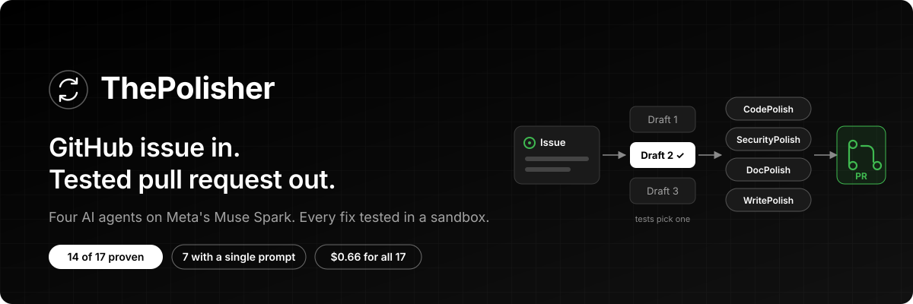
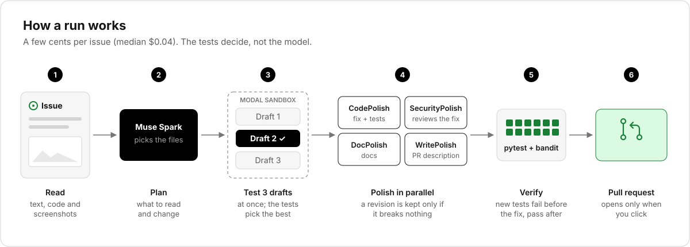
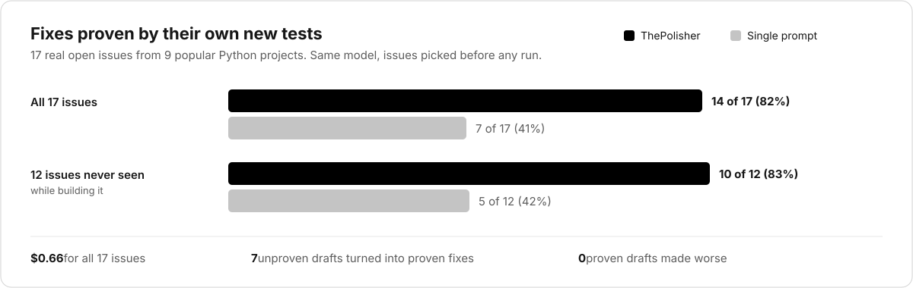
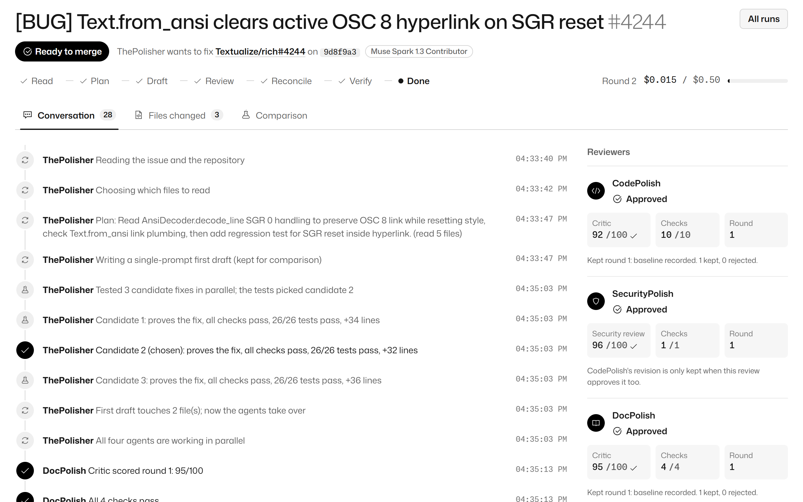
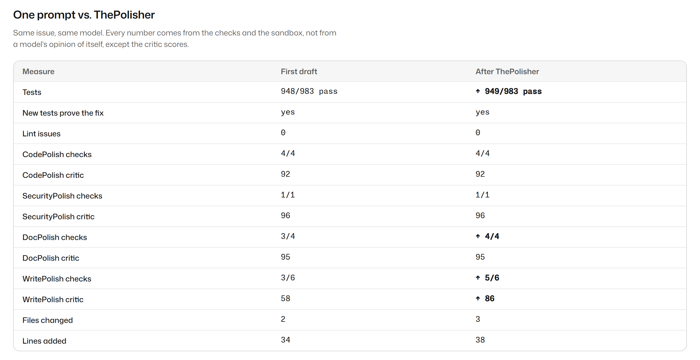
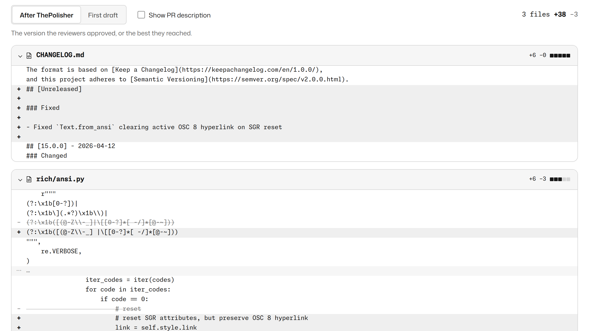
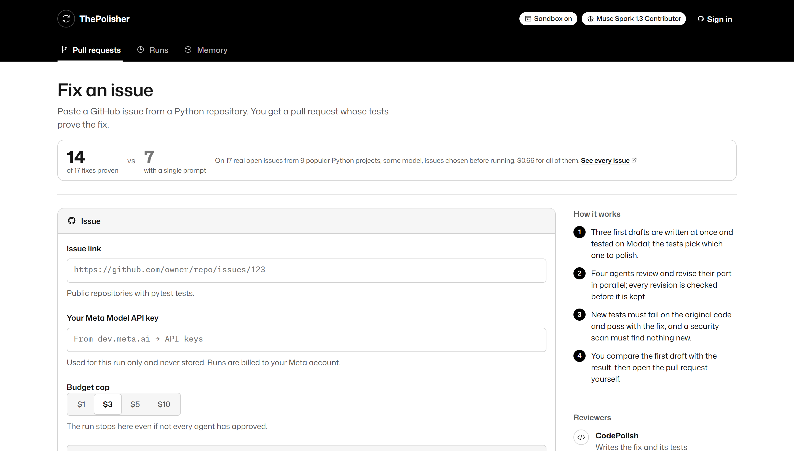

<div align="center">



<br>


**Paste a GitHub issue. Get a pull request whose tests prove the fix.**

[Try it](https://thepolisher.pages.dev) · [How it works](#how-it-works) · [Results](#results) · [Screenshots](#screenshots) · [Architecture](docs/architecture.md)

</div>

---

> [!NOTE]
> Built for the **Meta Global AI Developer Hackathon**, *Push the Frontier* track.
> Try it at **[thepolisher.pages.dev](https://thepolisher.pages.dev)**. Sign in with GitHub and your first 3 runs are free. After that, bring your own Meta Model API key.

## The problem

AI can write a fix for an issue in seconds. You still have to check it. Does it fix the bug? Did it break something? Are there tests? Is the PR description true?

ThePolisher does that checking for you. It runs the tests in a sandbox, keeps only changes that make things better, and tells you plainly when it could not prove a fix.

## What it does

| | |
| --- | --- |
| **Reads** | The issue, its comments, its screenshots, and the code it needs. |
| **Drafts** | Three fixes at once. Each is tested in its own sandbox and the tests pick the best one. |
| **Polishes** | Four agents improve the code, security, docs and PR description in parallel. |
| **Proves** | New tests must fail on the original code and pass with the fix. |
| **Waits for you** | You compare the first draft with the result. The PR opens only when you click. |

## How it works



Every revision goes through a gate. It is kept only if it does not break a check that was passing. The critic score only breaks ties, so the model never grades its own work into the PR.

| Agent | Owns | Must pass |
| --- | --- | --- |
| **CodePolish** | The fix and its pytest tests | Compiles, no lint errors, all tests pass, new tests fail before the fix and pass after, no tests deleted or skipped |
| **SecurityPolish** | Reviews CodePolish's change | The bandit scan finds nothing new at medium or high, and its review approves |
| **DocPolish** | README and changelog | Docs updated, only names functions and files that exist |
| **WritePolish** | PR title and description | Clear summary, every changed file named, `Fixes #N` only when the tests prove it |

## Results



The 17 issues come from Rich, jsonschema, sqlglot, urllib3, Pygments, astroid, pyparsing, more-itertools and humanize. They were chosen and committed before any run. When ThePolisher could not prove a fix, it said so.

Full list, method and limits: [benchmarks/results/issues-2026-10-29.md](benchmarks/results/issues-2026-10-29.md).

A re-run the next day found two bugs. After fixing both, the five issues they had hurt were all proven, and the Rich issues took 3 to 5 minutes instead of 12 to 22. See [issues-2026-10-30.md](benchmarks/results/issues-2026-10-30.md).

## Screenshots

**A finished run.** Every step, every check and every agent's verdict, live as it happens.



**First draft vs. result.** Same issue, same model. The numbers come from the sandbox.



**The diff you would merge.**



<details>
<summary><b>The home page</b></summary>
<br>

</details>

## Safety

> [!IMPORTANT]
> **Nothing is pushed without you.** Opening a PR is always an explicit click, with a confirmation that names the repo.

- Repo code only runs in Modal sandboxes. They have no secrets and can only reach GitHub and PyPI.
- Agents can only change Python source, tests and existing docs. Workflows, packaging and config files are off limits.
- Issue text, comments and repo files are treated as untrusted data in every prompt.
- Your Meta key is used for the run only, unless you tick "Remember". Then it is stored encrypted. GitHub tokens are encrypted too.

## Learning from runs

After each keep or reject decision, the agent records what it tried and what happened. Before its next revision, it recalls what worked on the same failing checks and what broke things.

Lessons are shared across users, so they are only saved from runs that end clean or verified, and each one is trimmed. A bad run cannot teach the others. Lessons are hints. The gate still decides.

## Run it locally

Needs Node 20+ and pnpm.

```bash
pnpm install
pnpm build
```

**Demo, no keys needed.** A built-in demo repo with scripted model and test results. The orchestrator, gate, checks and memory are real.

```bash
pnpm --filter @thepolisher/web dev:sim
```

**Real runs.** Copy `.env.example` to `.env` and set:

- **Model:** `MODEL_BASE_URL` and `MODEL_API_KEY`. `MODEL_ID` defaults to `muse-spark-1.3-contributor`, Meta's lower-cost tier. Meta may train on what is sent to it, so use it on public repos only.
- **Sandbox:** deploy `sandbox-service/modal_app.py` (steps are in its header), then set `SANDBOX_URL` and `SANDBOX_TOKEN`.
- **GitHub (optional):** `GITHUB_TOKEN` for higher rate limits. Needed for **Open PR**.

```bash
pnpm --filter @thepolisher/web dev
```

Then open http://localhost:3000.

## Limits

- Python repositories with pytest. Public repos only.
- The first run on a repo installs its dependencies, which takes 30 to 90 seconds. Later runs on the same commit use a cache.
- A run stops at its budget or after 20 minutes and keeps the best version so far.

## Built during the hackathon

Everything here was written between Oct 27 and Nov 4, 2026. There is no earlier codebase.

| Part | Where |
| --- | --- |
| Keep or reject gate, cost and round limits | `packages/core` |
| Pipeline and the four agents | `packages/agents/src/maintainer` |
| Sandbox with pytest, ruff and bandit | `sandbox-service/` |
| Memory from runs | `packages/agents/src/memory` |
| Web app and API | `packages/web` |

Third-party code is limited to the open-source packages in the `package.json` files, Line Awesome icons (MIT), and the Mona Sans and Monaspace fonts (OFL).

## Development

```bash
pnpm test
pnpm typecheck
```

How a run flows, where each part is deployed, and what is stored: [docs/architecture.md](docs/architecture.md).

## License

[MIT](LICENSE)
