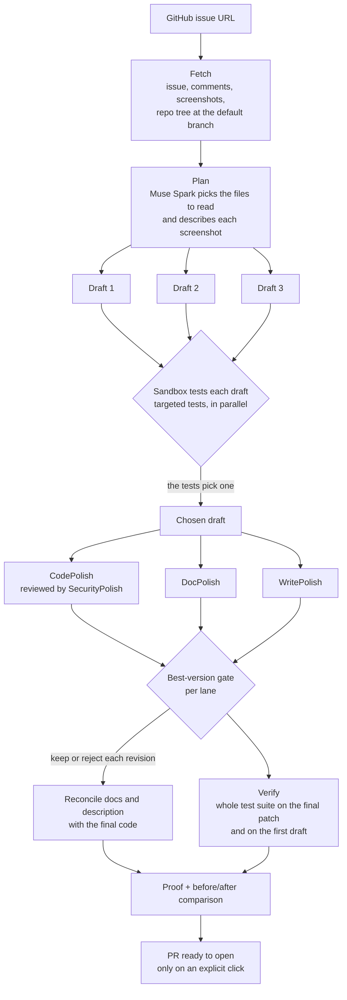
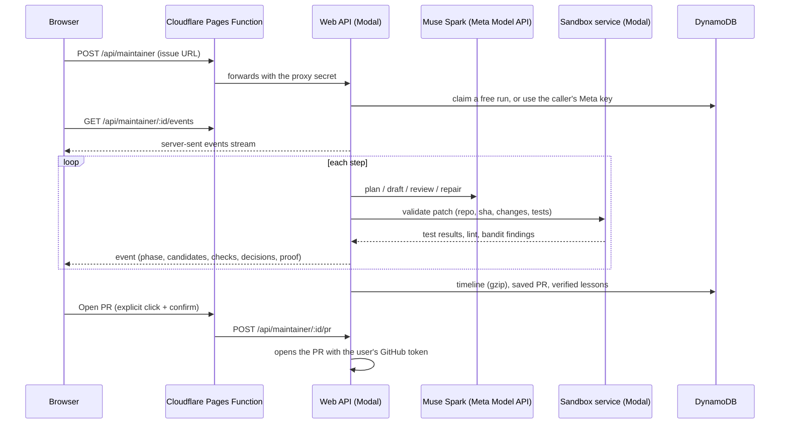
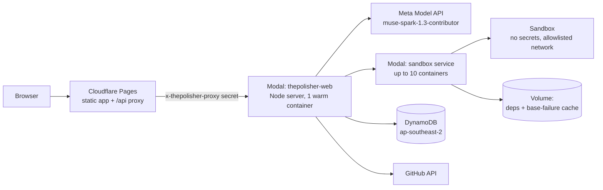

# Architecture

ThePolisher takes a GitHub issue from a Python + pytest repository and returns a pull request whose new tests are run in a sandbox: they fail on the original code and pass with the fix. This page covers how a run moves through the system, where each part is deployed, and what is stored.

## The pipeline



### Stages

| Stage | What happens | Code |
|---|---|---|
| Fetch | Reads the issue, its comments and the repo at one commit. Screenshots are only taken from GitHub-hosted URLs. | `maintainer/github.ts`, `maintainer/issue-images.ts` |
| Plan | One Muse Spark call (`reasoning_effort: minimal`) picks the files to read and writes a note for each screenshot. Files from 40 to 200 KB are sent as excerpts and edited with exact find/replace. | `maintainer/prompts.ts`, `maintainer/large-files.ts` |
| Drafts | Three single-prompt drafts are written in parallel. Each one is tested in its own sandbox, and the tests choose between them: does the draft prove the fix, how many checks fail, how big is it. Slow drafts get a 60-second grace period after the first one finishes. | `maintainer/candidates.ts`, `maintainer/settle.ts` |
| Polish | Each of the four agents works in its own lane. CodePolish owns the code and tests, and SecurityPolish reviews it. DocPolish owns the docs, and WritePolish owns the PR title and description. Each agent follows a playbook of principles. | `maintainer/lanes.ts`, `maintainer/playbooks.ts` |
| Gate | Every revision is checked against the best version so far, and kept only if it improves things. A revision that breaks a passing check is rejected. The one exception is a minor check (lint, debug leftovers, message style), which may break if the revision fixes more checks than it breaks. | `core/controller/best-version-gate.ts` |
| Reconcile + verify | These run in parallel. Reconcile brings the docs and the PR description in line with the final code. Verify runs the whole test suite on the final patch and on the first draft. | `maintainer/orchestrator.ts` |
| Proof | Records which new tests failed on the base commit and pass after the fix. The Proof card on the run page shows this. | `maintainer/proof.ts`, `web/components/ProofCard.tsx` |

### Limits on every run

- **Budget:** $3 of model spend by default. Free runs have a lower cap, set on the server.
- **Time:** 20 minutes. When time runs out, the run stops with status `time_limited` and keeps the best version so far.
- **Rounds:** up to 6 per lane. CodePolish gets one polish round after its checks pass; DocPolish and WritePolish stop as soon as theirs pass.

Every lane runs on the same `LoopController`: `packages/core/src/controller/loop-controller.ts`. So the gate, budgets, limits and memory are one tested piece of code, not four.

## The life of a run



The browser builds its view only from the event stream, using one pure reducer: `packages/web/src/maintainer/reducer.ts`. A finished run replays from its saved timeline through the same reducer, so a live run and a replay look the same.

## Deployment



| Part | Where | Notes |
|---|---|---|
| Frontend | Cloudflare Pages (`packages/web/dist`) | React 19 + Vite |
| API proxy | Pages Function `packages/web/functions/api/[[path]].ts` | Adds the proxy secret and follows Modal's redirect. Browsers never talk to Modal directly. |
| Web API | Modal, `deploy/modal_web.py` | The esbuild bundle `packages/web/dist-server/server.mjs`. Keys come from Modal secrets. |
| Sandbox service | Modal, `sandbox-service/modal_app.py` | One Modal Sandbox per validation: 1 CPU, 2 GB, 15 minutes at most. Outbound traffic is limited to GitHub and PyPI. The sandbox gets no secrets. |
| Dependency cache | Modal Volume `thepolisher-sandbox-deps` | Stores the installed venv for each repo commit, plus the tests already failing on that commit. Repeat runs skip the install. |
| Storage | DynamoDB table `thepolisher` | A free-tier table (10 RCU/WCU). Writes back off when throttled. |

## Storage

All records live in one DynamoDB table, keyed by a partition key and a sort key.

| Key | Holds |
|---|---|
| `RUN#id` / `META` | Run summary: issue, status, cost, timing, and whether it was a benchmark run |
| `RUN#id` / `EV#nnnn` | The timeline, gzip-compressed in pages |
| `RUN#id` / `PR#nnnn` | The finished PR (diffs and description), gzip-compressed, so it can still be opened later |
| `FEED` | The list of recent runs for the Runs page |
| `USER#login`, `SESSION#hash` | GitHub sign-in. GitHub tokens are encrypted at rest. |
| `METAKEY#githubId` | A user's Meta key, stored only if they tick "Remember", and encrypted per user |
| `FREE#githubId`, `FREEDAY#date` | Free-run counters, using conditional writes so two tabs can't both claim the last run |

Locally, `file-store.ts` implements the same interface with JSON files: `packages/web/src/server/store/`.

### Memory

Agents recall lessons from earlier runs: what worked, and what to avoid. The store is shared by every user, so a lesson ends up in other people's prompts. Two rules follow from that:

- A run's lessons are only saved if the run ends `clean` or `verified`.
- Each lesson is trimmed in length and count.

The code is in `packages/web/src/server/store/verified-memory.ts`. This way a failed or malicious run can't plant instructions for everyone else.

## Trust boundaries

- **Issue text, comments, screenshots and repo files are untrusted.** They reach the model as data inside delimited blocks, never as instructions.
- **Repo code only runs in the sandbox.** It has no secrets, no network beyond GitHub and PyPI, and a time limit.
- **Changes can't touch protected paths.** CI config, `.git`, `.env` files, key files and packaging config (`pyproject.toml`, `setup.py` and the like) are blocked from any patch, as are absolute paths and `..`. CodePolish may only change Python files, and DocPolish only docs the repo already has. The list is in `bundle.ts`.
- **Keys stay on the server.** The Meta key is used for the run only, unless the user ticks "Remember". GitHub tokens are encrypted, and the browser never sees either.
- **A PR is only opened on an explicit click,** with a confirmation that names the repo. Nothing is pushed automatically.

## Packages

```
packages/
  core/     LoopController, best-version gate, cost and iteration limits, diff utils, run types
  agents/   Muse Spark client, structured output, experience memory, and maintainer/ (the pipeline)
  web/      React app, Node server (server/), Pages Function (functions/), store adapters
sandbox-service/   Modal app that installs deps and runs pytest, ruff and bandit on a patch
deploy/            Modal web deployment, AWS setup, secrets script
benchmarks/        Issue lists, the runner, and results (jsonl + write-ups)
```
